<!-- EMERALD / AFTER DARK — SHIVAM SUTHAR GITHUB PROFILE README -->

<b><code>$ intro</code></b>

  

  

---

<b><code>$ about</code></b>

  

  

---

<b><code>$ tech_stack</code></b>

  

  

---

<b><code>$ selected_work</code></b>

<b><code>// 01 · SELECTED PROJECTS</code></b>

| **01 · CEVORA** — *AI Placement Platform* | **02 · LUMINI AI** — *Curriculum Gap Analyser* |
| :--- | :--- |
| A placement journey platform designed to bring career preparation and placement-related experiences into a unified digital environment.  **Tech Stack:** ⚛️ `React` · 🌐 `Next.js` · 🔷 `TypeScript` · ⚡ `Prisma` · ⚡ `Supabase` · 🐘 `PostgreSQL` · ♊ `Gemini AI`  [📦 Repository](https://github.com/shiv-05-07/cevora) · [🔗 Live Demo](https://cevora.vercel.app/) | An AI-powered curriculum gap analyser designed to help identify differences between learning curricula and uncover missing concepts.  **Tech Stack:** ⚛️ `React` · 🌐 `Next.js` · 🔷 `TypeScript` · ♊ `Gemini AI` · 🟢 `Node.js` · 📄 `PDF Parsing` · 🕸️ `Neo4j`  [📦 Repository](https://github.com/shiv-05-07/Lumini-Ai) · [🔗 Live Demo](https://luminiaisynapsex.vercel.app/) |
| **03 · GLOBETROTTER** — *Full-Stack Travel Planning* | **04 · VOYAGEX** — *Java Desktop Application* |
| A personalized multi-city travel planning workspace designed to organize destinations and travel itineraries in one place.  **Tech Stack:** ⚛️ `React` · 🔷 `TypeScript` · 🟢 `Node.js` · ⚡ `Express` · 🗄️ `SQLite` · ♊ `Gemini AI`  [📦 Repository](https://github.com/buildwithpriince/odoo-TEAM-MSU-) | A desktop travel planner and itinerary manager that helps users organize trips, transportation, activities, and expenses.  **Tech Stack:** ☕ `Java 8` · 🖥️ `Java Swing` · 🔌 `JDBC` · 🗄️ `SQLite`  [📦 Repository](https://github.com/shiv-05-07/VoyageX) |

<b><code>// 02 · CURRENTLY EXPLORING</code></b>

| **CURRENT FOCUS** — *Active Exploration &amp; Engineering Areas* |
| :--- |
| Currently exploring deeper applications of generative AI, intelligent agents and scalable software systems.  🚀 `AI Agents & LLM Applications` &nbsp;·&nbsp; 🧠 `Advanced DSA & Problem Solving` &nbsp;·&nbsp; ⚡ `System Design & Architecture` |

  

---

<b><code>$ journey</code></b>

  

  

---

<b><code>$ developer_id</code></b>

  

  

---

<b><code>$ contributions</code></b>

  <picture>
    <source media="(prefers-color-scheme: dark)" srcset="assets/contributions/github-contribution-grid-snake-dark.svg">
    <source media="(prefers-color-scheme: light)" srcset="assets/contributions/github-contribution-grid-snake.svg">
    
  </picture>

  

---

<b><code>$ github_analytics</code></b>

  
  

  

  

  

---

<b><code>$ connect</code></b>

  

  &nbsp;&nbsp;&nbsp;&nbsp;&nbsp;&nbsp;

  

---

  

<!-- END OF SHIVAM SUTHAR PROFILE README -->
